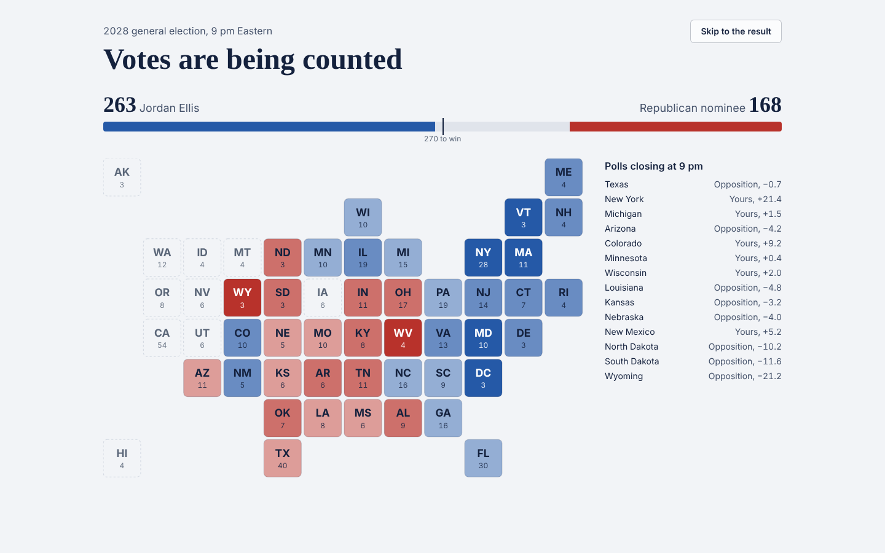
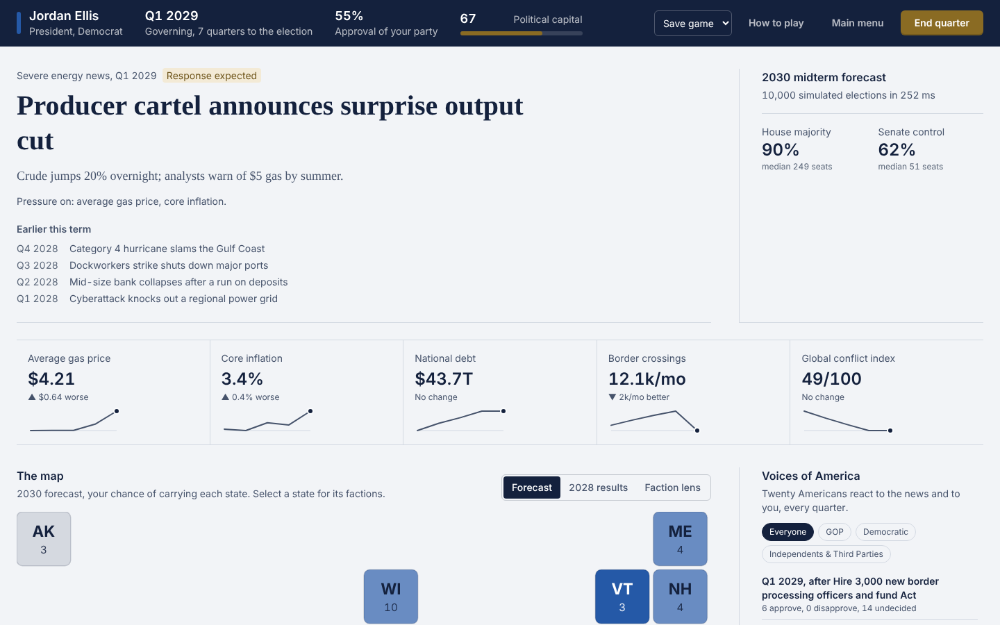
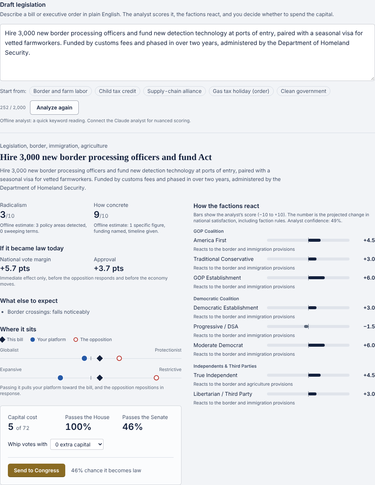
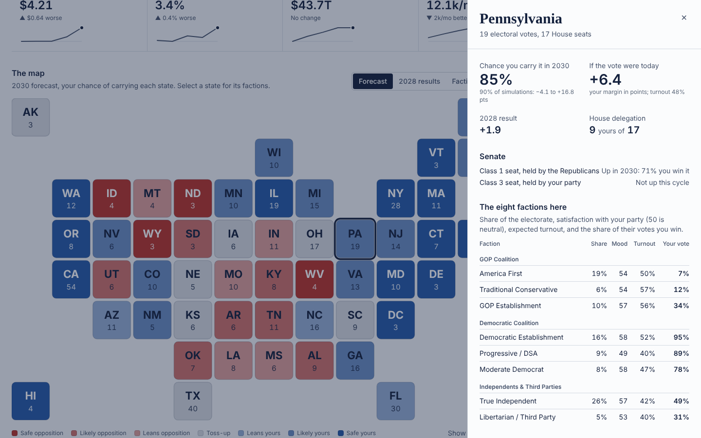
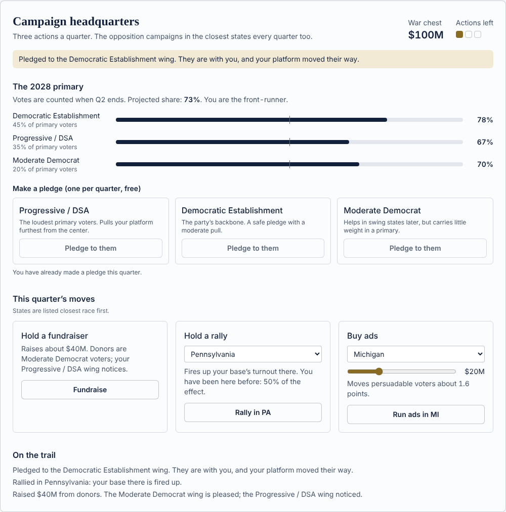
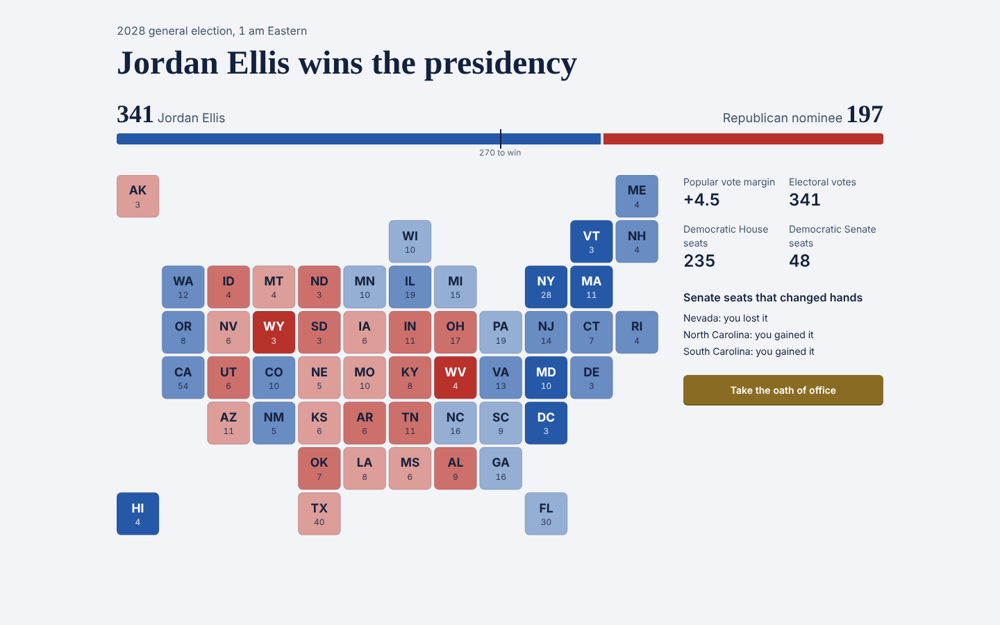
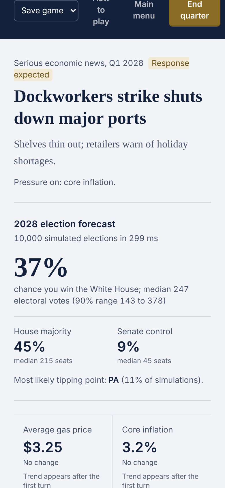
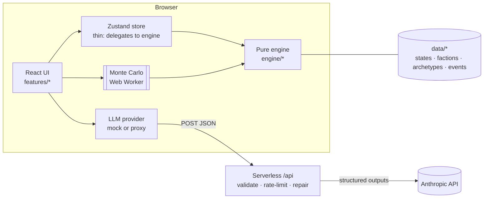

# Voices of America

**A text-based grand strategy game about American politics.** Run for president in 2028, win (or lose) on an election night simulated 10,000 times, then govern a country of eight restless factions by writing laws in plain English. Lose your base in a primary or lose the White House, and it's over; keep winning, and the game runs forever.

> **Live demo:** _add your deployed URL here_. It runs fully offline by default; connect an Anthropic API key for the real analyst and voices.



## What makes it interesting

- **The LLM interprets; the engine decides.** Claude reads a player's free-form bill and returns bounded scores and faction reactions through Anthropic's structured outputs. Everything after that (votes, seats, metrics, outcomes) is deterministic TypeScript you can unit-test and replay bit-for-bit from a seed.
- **An honest election forecast.** 10,000 Monte Carlo runs per update, in a Web Worker, in about 200 ms, with *correlated* error: a fat-tailed national swing, regional swings, per-faction turnout surprises mapped through each state's faction mix, and state noise. Battleground misses cluster the way real ones do, and tests assert it.
- **Eight factions, one engine.** Every state holds eight factions (three per party plus independents and libertarians) with their own ideal points, turnout elasticity and issue salience. The opposition isn't scripted AI: its platform deterministically mirrors whatever you push hardest, within a corridor around its natural center.
- **Run the government, not just Congress.** Sixteen departments (the fifteen cabinet departments and the EPA) show what they are working on. A president can redirect any of them by executive order, ask Congress to grow or cut a budget, or try to abolish a department. Every one of these actions becomes a `BillAnalysis` and runs through the same vote, court and effect pipeline as a bill the player writes. Bills, executive orders and budget requests each get their own quarterly slots.
- **Real opponents, then fictional ones.** Through 2036 the other party's nominee and your primary rival are drawn from weighted pools of real national politicians; after that the game generates candidates. Draws are seeded per cycle, so a game always faces the same field. Opponents have charisma, fundraising and discipline ratings that shape debates, ad wars and how well your attacks land. They are fictionalized: the game never puts words in their mouths.
- **Negative campaigning with real tradeoffs.** Hit the opponent's record where they sit farther from independents than you do, build and release an opposition-research file, run attack ads that depress their turnout, or staff a rapid-response team against their attacks. Each negative move raises the odds of a backlash and dulls the next one.
- **Twenty human voices.** A retired Ohio machinist, an Atlanta tenant organizer, an Arizona suburban mom and seventeen others react each quarter. The engine computes each person's mood from the simulation; the model only writes the words, and the server corrects any post that contradicts its mood.

## Screenshots

| | |
|---|---|
|  The dashboard: crisis brief, live forecast, metrics |  Bill drafting: analysis, faction reactions, projected impact |
|  Any state's eight-faction breakdown |  Campaign HQ during the primary |
|  The result, with Senate seats that flipped |  Responsive down to phone width |

## Architecture



- **`src/engine`** is pure: no React, no network, no clock, no `Math.random` (enforced by ESLint). One `GameState` (about 57 KB of JSON) is the whole game, so saves are exact and replays are deterministic.
- **`src/domain`** holds the canonical IDs and the Zod schemas. One schema drives the LLM contract, the API's JSON Schema, server validation, client validation and save files.
- **`api/`** is framework-free handlers behind Vercel Functions, also mounted into `vite dev`. It holds the API key; the browser never does.

More: [architecture](docs/ARCHITECTURE.md), [simulation model](docs/SIMULATION_MODEL.md), [LLM layer](docs/LLM.md). Decision records: [reactive opposition](docs/ADRs/001-reactive-opposition.md), [tile map](docs/ADRs/002-tile-map.md), [structured outputs](docs/ADRs/003-structured-outputs.md)

## Tech stack

React 19 · TypeScript (strict, `noUncheckedIndexedAccess`, `exactOptionalPropertyTypes`) · Vite · Tailwind CSS 4 · Zustand · Zod 4 · Vitest · Anthropic TypeScript SDK · Vercel Functions

## Getting started

```bash
git clone https://github.com/billytheballer/voices-of-america.git
cd voices-of-america
npm install
cp .env.example .env     # VITE_LLM_MODE=mock: fully offline, no key needed
npm run dev              # http://localhost:5173
```

To use Claude for bill analysis and the voter feed:

```bash
npm install @anthropic-ai/sdk@latest
# in .env:
#   VITE_LLM_MODE=proxy
#   ANTHROPIC_API_KEY=sk-ant-...
npm run dev              # the Vite dev server also serves /api, keeping the key server-side
```

| Script | |
|---|---|
| `npm test` | 239 unit, integration and soak tests (engine, simulation, schemas, LLM pipeline, API handlers, persistence, store) |
| `npm run coverage` | Tests with V8 coverage for the engine and domain |
| `npm run typecheck` / `npm run lint` | Strict TypeScript and ESLint (including the engine purity rules) |
| `npm run build` | Production build |

## Deploying (Vercel)

1. Import the repository in Vercel (the Vite preset is detected; `vercel.json` sets the rest).
2. Environment variables: `ANTHROPIC_API_KEY`, optional `ANTHROPIC_MODEL` (default `claude-sonnet-5-5`), `ALLOWED_ORIGINS` (your site's URL), and `VITE_LLM_MODE=proxy`. Or leave it at `mock` for a free public demo.
3. Deploy. `/api/parse-bill` and `/api/generate-feed` become serverless functions.

## Project structure

```
api/                    Serverless handlers (+ Vite dev middleware)
src/
  domain/               IDs, types, Zod schemas (the contracts)
  data/                 States, factions, archetypes, events, campaign and balance tuning
  engine/               Pure simulation: electorate, economy, legislature, government
                        (departments), campaign (+ race/opponents), opposition,
                        Monte Carlo, game loop
  services/             LLM providers and prompts, persistence, worker client
  store/                Zustand store + selectors
  features/             UI by feature: dashboard, map, drafting, government, feed,
                        campaign, election night
docs/                   Architecture, model, LLM layer, ADRs, screenshots
```

## Accessibility

Keyboard-playable throughout (skip link, visible focus, arrow-key map navigation), WCAG AA text contrast measured on every surface and map shade, map colors validated for color-vision deficiency, a table view for every map lens, and reduced-motion support for election night.

## Limitations and next steps

- The offline analyst is a keyword reader: valid and playable, but far blunter than Claude.
- Rate limiting is per serverless instance; a shared store (Redis) would make it global.
- The House is modeled with a per-state seat–vote curve rather than 435 districts.
- Real candidate ratings are coarse game abstractions, and the 2028–2036 pools reflect the political landscape as of late 2026.
- Ideas: random campaign-trail events with choices, an opposition that drafts its own bills, per-state candidate quality, and a replay viewer built on the deterministic seed.

## License

MIT. See [LICENSE](LICENSE).
