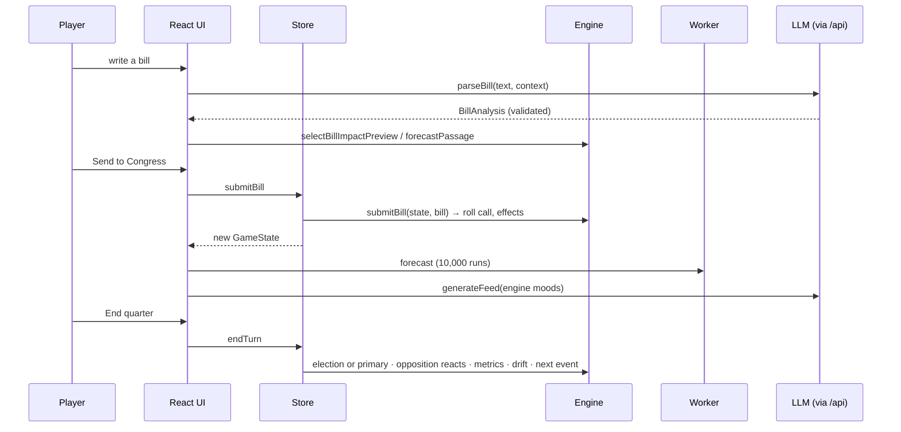

# Architecture

## Principles

1. **The LLM interprets; the engine decides.** Language models turn free text into bounded, validated numbers and write in-character prose. They never produce a stored vote count, probability or dollar figure.
2. **One state, pure functions.** The entire game is a single serializable `GameState`. Every rule is a pure function from state to state, so the game is testable, savable and replayable.
3. **One schema, many jobs.** Zod schemas in `src/domain/schemas` are the single source of truth for the LLM contract, the API's JSON Schema, server and client validation, and save files.
4. **Data over code.** Factions, states, archetypes, events, campaign effects and every balance coefficient live in `src/data`. Rebalancing never touches engine code.

## Layers

| Layer | May import | Must not |
|---|---|---|
| `domain` | (nothing app-specific) | React, services, store |
| `data` | `domain` | engine, services |
| `engine` | `domain`, `data`, `lib` | React, `services/*`, `store/*`, `features/*`, `fetch`, `localStorage`, `Math.random`, `Date.now` (ESLint-enforced) |
| `services` | everything below | React |
| `store` | `engine`, `services` | |
| `features` | everything | |
| `api` | `domain`, `data`, `services/llm` (relative imports only) | browser globals |

## A turn

## Determinism

`engine/rng.ts` is a seeded mulberry32 generator whose whole state is one integer stored in `GameState.rngState`. Actions that need randomness (votes, elections, events, debates) create a generator from that state and store the advanced state back. Forecasts derive their own seed from the game state without advancing it, so opening the forecast never changes the future. Tests assert that the same seed plus the same actions produce byte-identical games, and that a saved game continues identically.

## Performance

The Monte Carlo precomputes everything state-dependent (margins, turnout sensitivities) on the main thread, then runs in a Web Worker over typed arrays with no allocation in the hot loop. A chunked async generator streams progress, so the map fills in live and runs can be cancelled. 10,000 runs, including the House and Senate, take about 200 ms.

## Persistence

Saves are versioned JSON validated against the full `GameState` schema on load. Migrations upgrade older versions (v2 → v3 added campaign state); a corrupt or hand-edited save is rejected with a reason rather than crashing the game.

## LLM pipeline

See [LLM.md](LLM.md): request validation, rate limiting, structured outputs, Zod validation with a single repair attempt, mood reconciliation, and client-side re-validation.
